# BilliardsClubApplication
台球俱乐部小程序
亮点：AI智能客服、ECharts经营分析、多人拼桌与费用分摊、台球桌预约闭环、 俱乐部商城联动；
角色：用户、管理员；

所有源码均本人开发，项目是前后端分离的，所有的项目都具备了完整的业务逻辑，不仅仅局限于基础的增删改查（CRUD）操作，系统亮点众多。

本文注重于计算机毕业设计选题指导，列出题目均有源码， 大家可以去【公众号】(毕业终点站)获取或者加我【qq】(2112698948)提意见(别忘记Star哟)。备注：git

声明：仅用于学习使用，请勿用于任何商业行为！

1.系统非商用，非开源，非无偿。

2.由本人开发，如需源码，请联系以下方式，qq:2112698948。

3.项目有很多，并未全部上传，如果未找到想要的，可直接咨询。

# 台球俱乐部小程序

> uni-app 微信小程序 + Vue 3 管理后台 + Spring Boot 3 服务端。用户在小程序里订台、拼桌、逛商城、问 AI 客服，管理员在后台维护球桌、配分时价格、核销订单、看经营数据。

做这套系统起因挺实在——身边开球房的朋友算账全靠一本手写本，谁订了几号桌、几点到几点、是不是拼桌摊的费用，一到周末就对不上。台球这门生意的时间颗粒度太细了：同一张桌子下午和晚上不是一个价，两个人拼一桌要各付一半，拼不成还得退。所以这套东西把重点放在**分时计价**和**拼桌费用分摊**上，订台、到店核销、商城卖饮料球具这几条线也都做成了能点得动的样子。

## 技术栈

| 层次 | 技术选型 |
| --- | --- |
| 架构 | B/S、MVC、前后端分离、微信小程序端 + 管理后台、管理员与普通用户双角色 |
| 服务端 | Java 17、Spring Boot 3.3.1、Spring MVC、MyBatis-Plus、MySQL、JWT、DeepSeek API、SSE |
| 管理后台 | Vue 3、Vite、Element Plus、Vue Router、Pinia、Axios、ECharts |
| 小程序 | uni-app、Vue 3、Pinia、微信小程序 API、uni-ui、腾讯地图 |
| 开发工具 | IDEA、Maven、HBuilderX、微信开发者工具、Node.js |

## 功能亮点

**1. 分时计价的台球桌预约**
球桌按桌型分组，选桌时先看类型、区域和单价，再进详情选日期和时段。日期是七天滚动条（今天到后面六天），时段按整点排开，已预约、未配置、已选中三种状态用颜色区分，选完时段总计费用实时算出来。同一张桌子白天和晚上可以是两个价，价格不写死在前端。

**2. 多人拼桌与费用分摊**
用户可以自己发起拼桌，也可以输入拼桌码加入别人的局。发起时设定桌型、时段、人数上限、性别要求、年龄要求和技术水平，成团后按人数把总费用摊开，成员各自支付。拼桌大厅支持按桌型、性别要求、技术水平筛，报名前就能看清这局是什么水平、还差几个人。

**3. AI 智能客服**
接的是 DeepSeek，通过 SSE 把回答一个字一个字推回来，不是等整段生成完再一次性显示。问的多是营业时间、怎么收费、能不能预约、拼桌怎么算钱、店里卖什么这类问题，会话和消息都留了记录可以回看。

**4. ECharts 经营分析**
预约分析页四张卡片给出总预约数、总营收、已核销订单和拼桌预约数，下面四张图分别是订单状态分布、近七天预约量、近七天营收趋势和拼桌占比。状态分布的占比是按总数真实算出来的，不是摆几个好看的数。

**5. 预约订单与到店核销**
订单按待支付、已支付待使用、已核销、已取消分状态，后台可以按用户、球桌、状态、是否拼桌和日期区间筛选。到店后管理员在核销页输入核销码就能查到订单并核销，不用再翻订单列表找人。

**6. 俱乐部商城联动**
饮品、零食、台球装备、配件、球杆五个分类，支持关键词搜索和按综合、销量、价格排序。加购物车、改数量、结算、查商品订单都在同一个小程序里完成，打完球顺手买瓶饮料不用另开一个系统。

**7. 双角色各管一摊**
用户端只负责订台、拼桌、买东西、问客服；管理后台管账号、场馆信息、球桌类型、球桌资料、时段价格、预约订单、核销、拼桌、商品、订单和统计。两边数据同源，球桌一改价格小程序端立刻按新价算。

## 系统角色与界面

### 登录入口

管理后台登录页，账号密码进入，页面底部注明"如需开通账号，请联系管理员"，账号由管理员统一分配，没有开放注册。

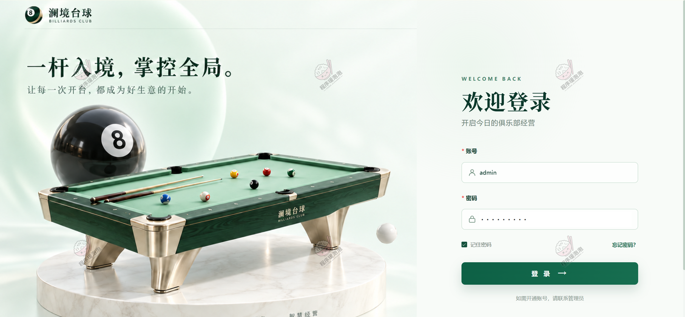

### 一、用户端（微信小程序）

**首页**
左图从上到下是轮播图、场馆公告条、四个快捷入口（预约台球桌、商品商城、AI 客服、加入拼桌）、我的预约卡片，再往下接可选球桌。公告条直接写清楚本店有多少张台球桌，不用点进详情去数。我的预约卡片给出订单号、预约日期时段、桌号和金额，状态是"已支付待使用"。右图是可选球桌的网格，六张桌按 D、C、B 区分区域，D01 标着"维护中"、其余是"空闲"，单价从 ¥35/时到 ¥80/时。底部五个 tab 是首页、商城、拼桌、订单、我的。

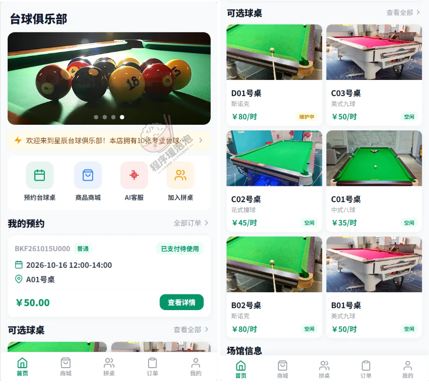

**台球桌列表与预约详情**
左图按全部、中式八球、美式九球、斯诺克、花式撞球筛选，每张卡片带桌号、桌型、区域（D 区-VIP 区、C 区-休闲区）、每小时单价和当前状态，维护中的那张不给"立即预约"按钮，直接拦住。右图是 C03 号桌的详情：桌型美式九球、区域 C 区-休闲区，还有一句说明"适合朋友聚会娱乐，配有舒适沙发座椅"。下面是选日期，七天横排、今天到周二，图例分开标了可预约、已预约、未配置和已选中；再往下是整点排开的时段格，凌晨没排班的时段是灰的"未配置"。底部总计费用随选中时段变，右侧两个按钮一个是发起拼桌、一个是确认预约——同一张桌子既可以直接订，也可以拉人拼。

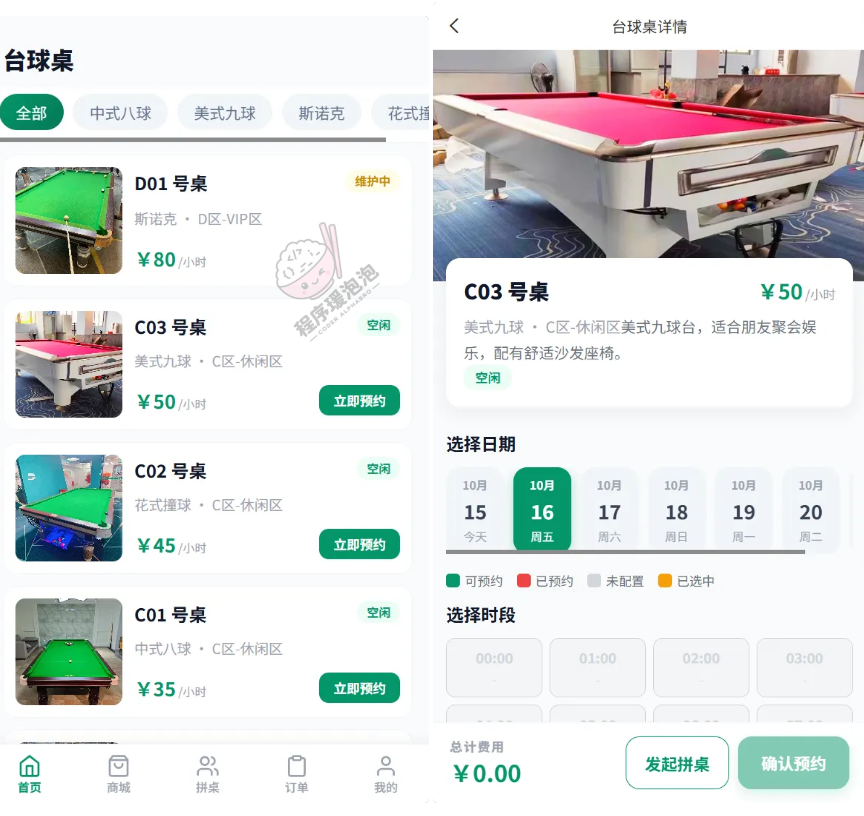

**拼桌大厅与拼桌详情**
左图是拼桌大厅，顶部按桌型、性别要求、技术水平筛选。三张卡片能看出组局的颗粒度：郑十的"中式八球·下班后的台球时光"标了仅限女生、业余，总费用 ¥100、人均 ¥50；陈一的"美式九球·新手友好练球局"是进阶水平，¥120 人均 ¥60；张三的"斯诺克·周末休闲约球"是仅限男生、高手，¥180 人均 ¥90。每张卡都写清 1/2 人，还差一个人。右图是拼桌详情：拼桌码 SF261015008 可以复制分享，预约信息列出球桌 B01 号桌、桌型美式九球、日期 2026-10-16、时段 18:00–20:00、总费用 ¥120.00；拼桌要求把人数上限 2 人、性别不限、成年人、进阶水平摊开写；成员区显示 1/2 人，陈一那条标着分摊 ¥60.00、待支付。

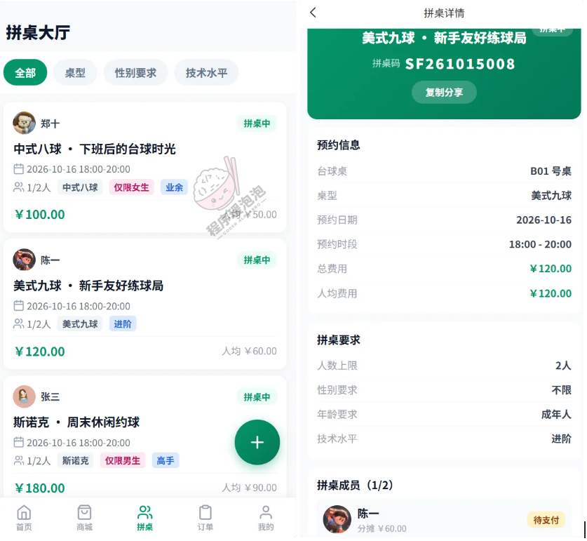

**我的拼桌管理**
左右两屏分别是"我发起的"和"我加入的"，同一条拼桌在两边显示的是不同口径的金额：斯诺克·周末休闲约球在发起侧是总费用 ¥180.00，在加入侧是人均 ¥90.00；中式八球·周末球友切磋是 ¥80.00 对 ¥40.00；C01 球桌·球友练习局是 ¥70.00 对 ¥35.00。二分之一的关系一眼能对上，说明分摊是按人数实际算的，不是前端写死。1/2 人的局状态是"拼桌中"，还给着"立即成团"和"取消拼桌"两个操作；凑满 2/2 的局状态变成"已生效"。拼桌码也印在卡片右下角，方便当面报给对方。

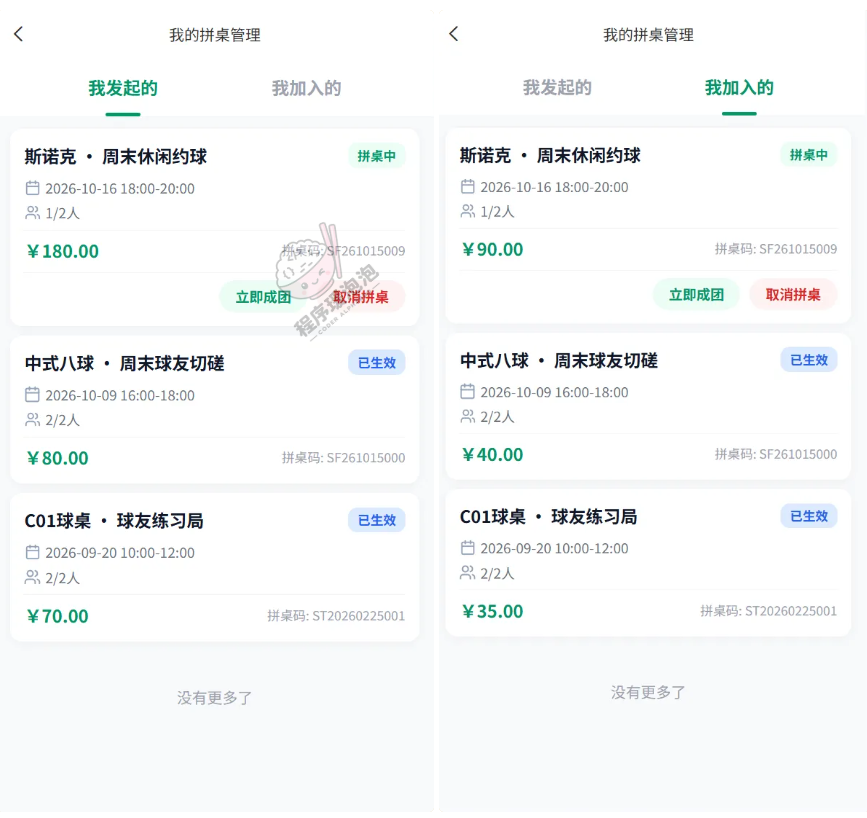

**我的订单**
左图是预约订单，状态分全部、待支付、已支付待使用、已核销、已取消。两条单子都是 A01 号桌，10-16 的 12:00–14:00 是 ¥50.00，10-15 的 10:00–12:00 是 ¥80.00——同一张桌子不同日期不同时段价格不同，这是分时计价最直接的体现。右图是商品订单，状态多出待发货的环节：可乐 ¥5.00 加红牛 ¥8.00 两罐，合计 ¥21.00；另一单是台球杆包 ¥89.00 两支加 LP 定制台球杆 ¥299.00 一支，合计 ¥477.00。两单的金额加得都对得上明细。

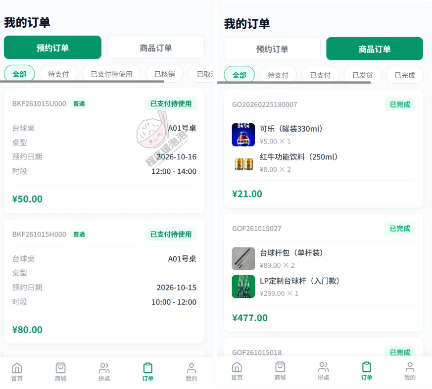

**俱乐部商城与购物车**
左图是商城，顶部搜索框，五个分类加综合、销量、价格三种排序，卡片上直接给已售数（台球手套右手已售 28、左手已售 62、台球杆包已售 22），选的时候能看出哪件好卖。右图是购物车，坚果混合装 ¥28 一件、台球杆皮头 ¥25 两件、LP 定制台球杆 ¥299 一件，四件合计 ¥377.00，加数量、减数量、删单都在行内完成，右下角直接结算。

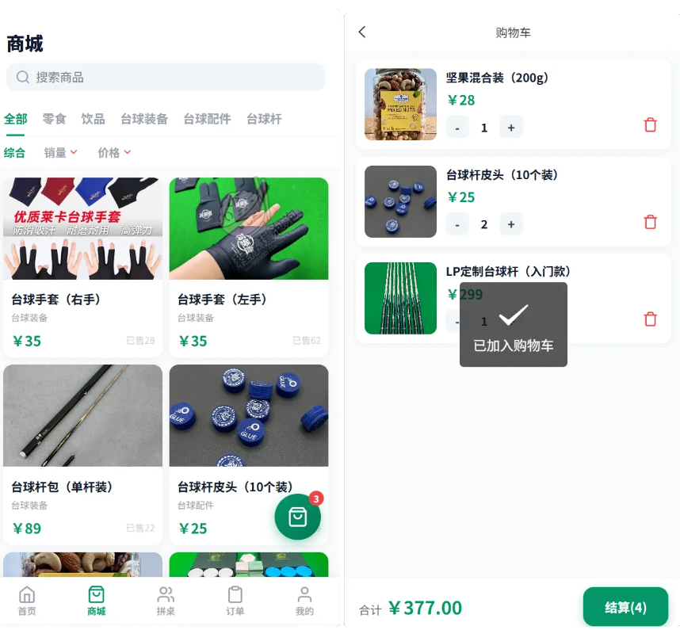

### 二、管理员端（Web 后台）

后台菜单分五组：系统管理下是账号管理和轮播图管理；场馆管理下是场馆信息、台球桌类型、台球桌管理、时段配置；预约管理下是预约订单、订单核销、预约分析；拼桌管理下是拼桌列表和拼桌分析；商城管理下是商品分类、商品管理和商品订单。

**台球桌管理**
球桌资料就在这里维护。表格列出桌号、台球桌类型、类型图片、单价、所属区域、台球桌状态、简介和操作，D 区两张是 VIP 区（D01 斯诺克 ¥80/时、D02 中式八球 ¥60/时），C 区三张是休闲区（C03 美式九球 ¥50/时、C02 花式撞球 ¥45/时、C01 中式八球 ¥35/时）。这里的单价和小程序端球桌列表完全一致：C03 美式九球 ¥50/时、C02 花式撞球 ¥45/时、C01 中式八球 ¥35/时，两个端看到的是同一份资料。状态只有空闲和维护中两种，维护中的球桌在小程序里不给预约入口。

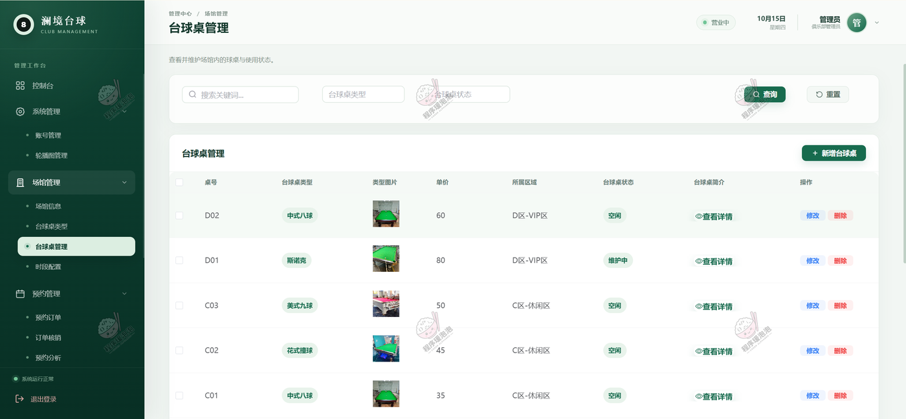

**时段配置**
价格按桌型分开配，左边先选桌型（花式撞球、斯诺克、美式九球、中式八球），右边是这张桌型一周七天的时段表，星期几后面跟着当天的时段条数（周一 2 条、周三 3 条）。花式撞球周三配了两段：10:00–18:00 八小时 ¥45/小时，18:00–24:00 六小时 ¥55/小时，备注写的是"花式撞球营业时段补充价"。白天 45 正好是球桌资料里的基础单价，晚上 55 是溢价——分时计价就是在这张表里配出来的，不是代码里写死的两套常量。

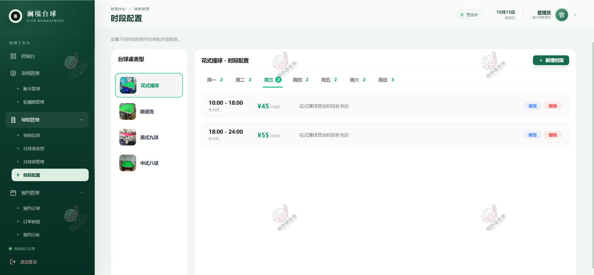

**预约订单**
查询条件给了用户、球桌、订单状态、是否拼桌和预约日期区间，找一张单子不用翻页。表格列出订单编号、用户、桌号、预约日期、开始与结束时段、总费用、订单状态和操作。这批单子都是 2026-10-16 12:00–14:00 两小时，A01 是 ¥50、B01 和 B02 是 ¥100、C01 是 ¥50、C02 是 ¥90、C03 是 ¥100，同样两小时不同球桌的总价不一样。状态统一是"已支付待使用"，到店核销之后才会往下走。

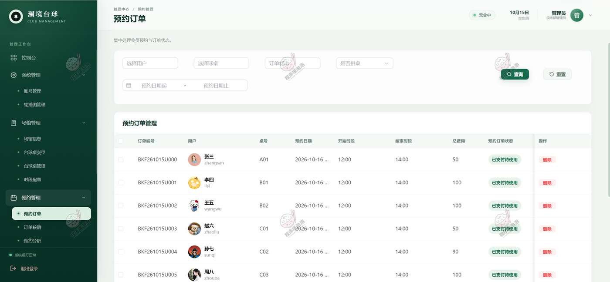

**订单核销**
到店环节单独一页，输入核销码查出对应订单再核销，核完订单状态从"已支付待使用"变成"已核销"。前台那张预约卡片上的核销码，就是在这里用的。

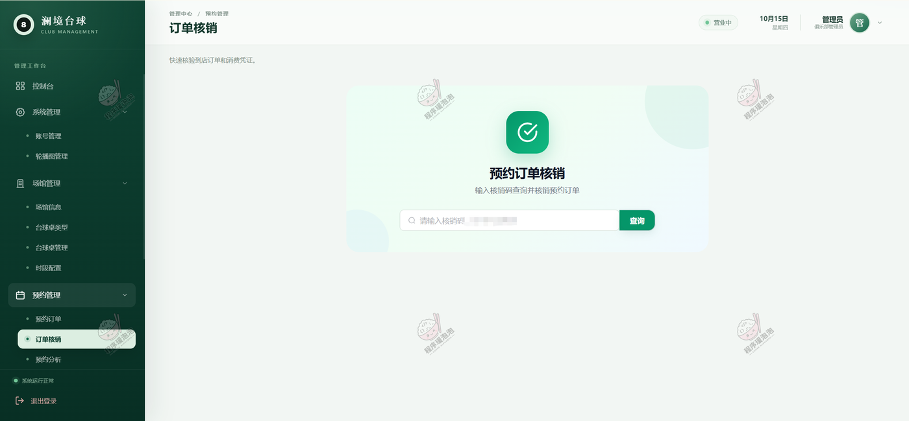

**预约分析**
四张卡片：总预约数 96、总营收 ¥5530.00、已核销订单 41、拼桌预约数 11。订单状态分布饼图里，已核销 42.71%、已取消 28.12%、已支付待使用 17.71%、已退款 11.46%、待支付 0%——41÷96、27÷96、17÷96、11÷96 和四个百分比逐个对得上，四个状态加起来正好 96，说明这张图是照真实订单算的。近七天预约量柱状图是 10-09 到 10-15 每天 2、4、3、2、4、3、2 单，共 20 单，周末明显高。右下角拼桌占比图里拼桌预约占 11.46%，也就是 11÷96。

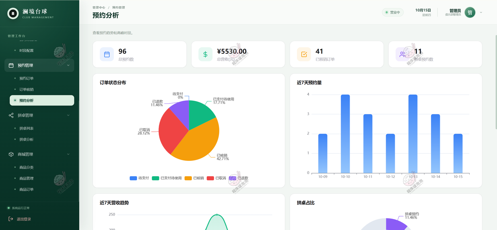

**拼桌列表**
管理员能看到所有拼桌活动。表格列出拼桌码、标题、发起人、桌型、台球桌、预约日期、时段、人数、总费用和操作，SF261015007 到 013 连着七条，发起人是郑十、陈一、张三、李四、王五、赵六、孙七，都排在 2026-10-16 的 18:00–20:00，人数清一色 1/2，总费用从 ¥100 到 ¥180。点"成员"能看这一桌都有谁、各自付了多少，点删除可以撤掉违规或长期凑不齐的局。这几条和小程序拼桌大厅、我的拼桌管理里的拼桌码、金额完全对得上——郑十那局后台记 ¥100、大厅显示总费用 ¥100 人均 ¥50、发起人视角的总费用也是 ¥100。

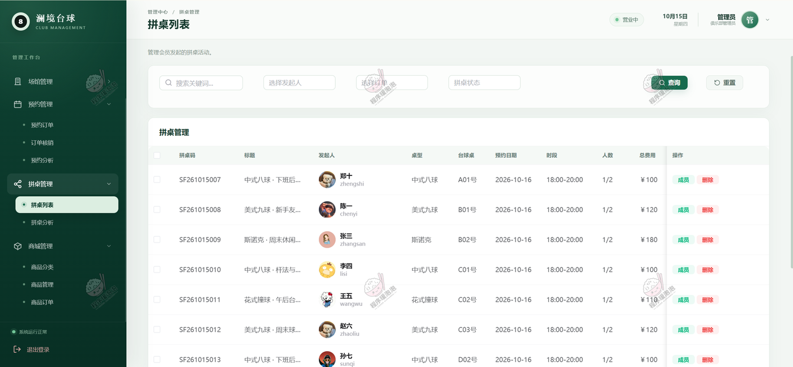

**商品管理**
商品按台球配件、台球装备、零食等分类管理，表格里有价格、库存数量、预警阈值、是否库存预警、销量和是否上架。库存预警是自动算的：台球桌清洁刷库存只剩 2，低于阈值 10，预警列直接打"是"；其余几件库存都在阈值之上，显示"否"。这样缺货不用一个个点进去看，列表里就能挑出来补货。台球杆包（单杆装）销量 22、坚果混合装销量 45，和小程序商城卡片上的已售数是一个数。

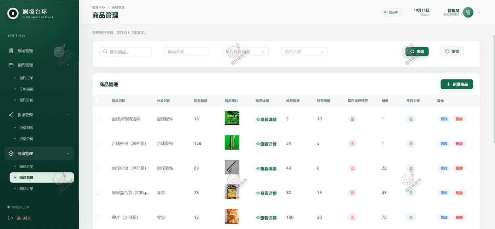

**商品订单**
查询条件里有订单状态，还有支付时间和取消时间两个区间，退款和取消的单子可以按时间段捞。表格列出订单编号、用户、订单总额、状态、支付时间、支付宝交易号和取消时间，状态覆盖已支付、已发货、已完成、已取消、已退款五种。GOF261015027 这张单在后台记的是张三、¥477、已完成，小程序"我的订单"里点开是同一个订单号、同样是 ¥477、同样已完成，前后台是同一份数据而不是各存一套。被取消的那单只有取消时间没有支付时间，被退款的则两个时间都在，字段是跟着状态走的。

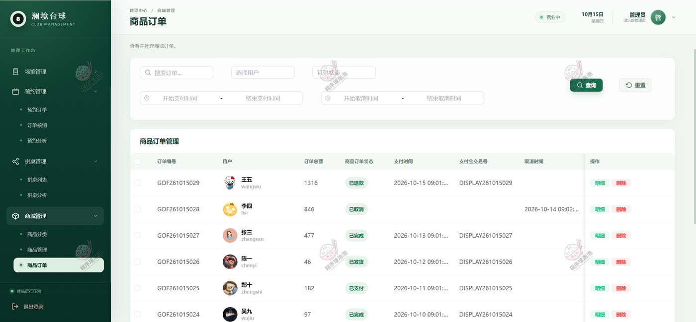

## 说明

- 文档展示 15 张截图，需要了解更多，请联系我。
- 截图中的球桌、订单、拼桌、商品均为演示数据，支付走模拟通道，AI 客服接的是 DeepSeek 接口。
- 系统按 B/S 架构部署，服务端 Spring Boot 3 + MySQL，后台 Vue 3 打包后由 Nginx 托管，小程序端用 HBuilderX 编译发布，地图导航走腾讯地图。
